# Manual Express: Fusión de Fibra Óptica

Manual técnico-pedagógico para usar en el banco de trabajo, desde el celular o el notebook.

**Asignatura:** Infraestructura de Redes (TCB304) | **Sede:** La Serena | 

**Autora:** Katherine Valle T.

---

## Glosario exprés

| Término | Definición |
|---|---|
| **Núcleo (core)** | Centro de vidrio de la fibra por donde viaja la luz. En monomodo mide cerca de 9 µm. |
| **Cladding** | Capa de vidrio que rodea al núcleo (125 µm en total). Refleja la luz y la mantiene dentro del núcleo. |
| **Cleaving** | Corte de precisión de la fibra para dejar una cara plana y perpendicular al eje, cercana a 90°. |
| **Atenuación** | Pérdida de potencia óptica de la señal, medida en dB. En un empalme por fusión se busca lo más cerca posible de 0 dB. |

### Datos técnicos clave

| Dato | Valor típico |
|---|---|
| Tipo de fibra | Monomodo (SM) |
| Núcleo | cerca de 9 µm |
| Cladding | 125 µm |
| Recubrimiento de acrilato | 250 µm |
| Buffer | 900 µm |
| Longitudes de onda habituales | 1310 nm y 1550 nm |
| Desviación del corte respecto a la perpendicular | idealmente menor a 1°, el límite exacto lo fija cada fusionadora |
| Pérdida buscada en un empalme por fusión | menor a 0,10 dB, con un máximo habitual de 0,30 dB |

> [!NOTE]
> Son valores típicos de referencia. Confirma los límites con el manual del equipo o con el docente.

---

## Materiales y herramientas

| Herramienta | Uso en la práctica |
|---|---|
| **Stripper de fibra CFS-2** | Pelado por etapas hasta dejar el vidrio de 125 µm. |
| **Pinza para chaqueta exterior** | Retiro de la cubierta del cable antes de llegar a la fibra. |
| **Regla guía de longitud** (canales 250 y 900) | Medir el largo de fibra a pelar según lo que pida el equipo. |
| **Cortadora SKL-60S** | Cleaving, corte perpendicular de la fibra. |
| **Alcohol isopropílico y paños sin pelusa** | Limpieza de precisión antes del corte y la fusión. |
| **Localizador visual de fallas (VFL, Visual Fault Locator)** | Inyecta luz roja en la fibra para verificar la continuidad del núcleo y ubicar cortes o fugas. |
| **Medidor de potencia óptica** | Medir potencia y pérdida del enlace. Tiene botones de encendido, AUTO OFF, ZERO, LIGHT, dB y λ (selección de longitud de onda). |
| **Fusionadora y protectores de empalme** | Disponibles en el laboratorio, no en mi set. |

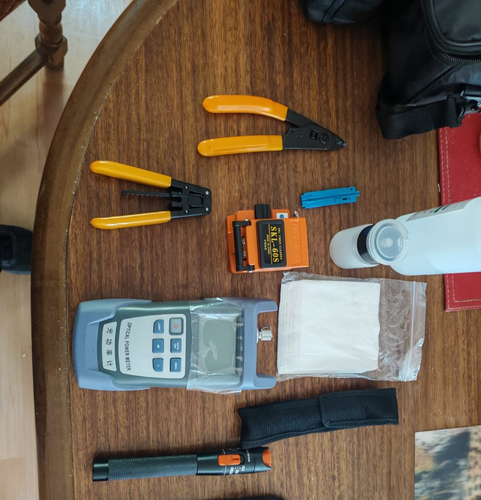

| Stripper CFS-2 | Pinza de chaqueta | Regla guía | Medidor de potencia |
|---|---|---|---|
| 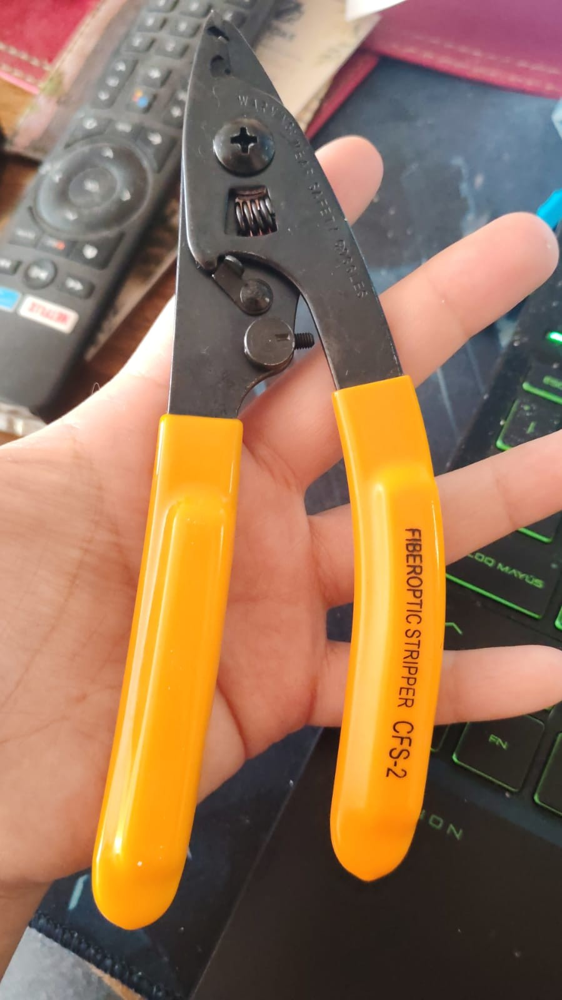 | 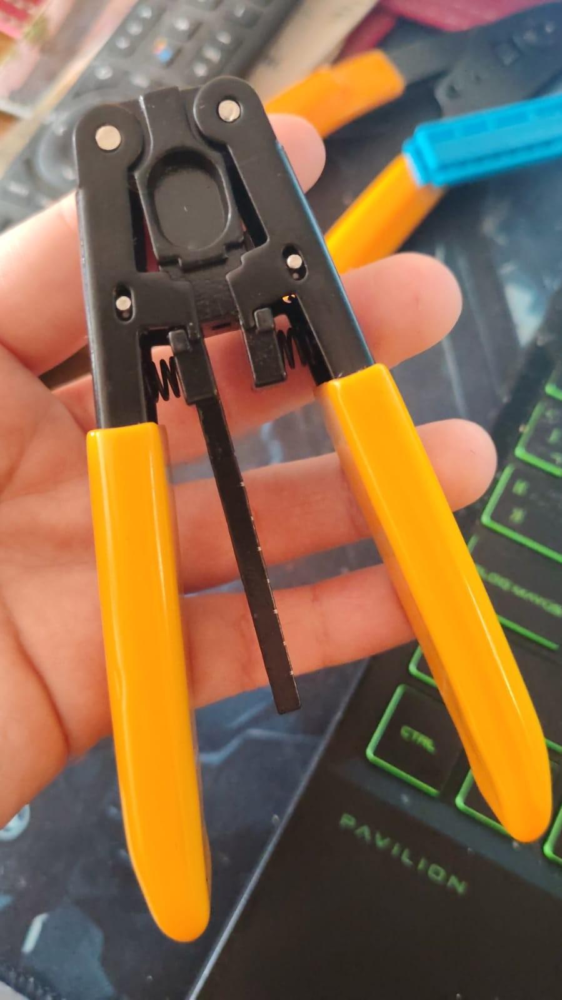 | 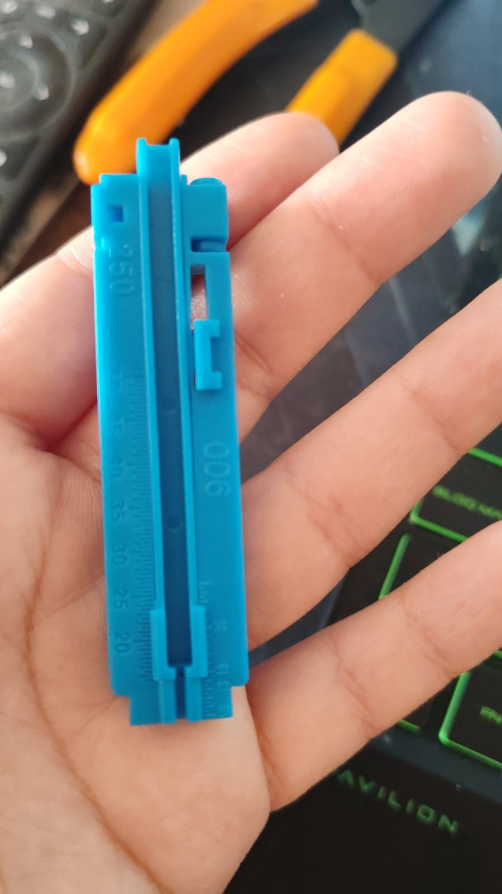 | 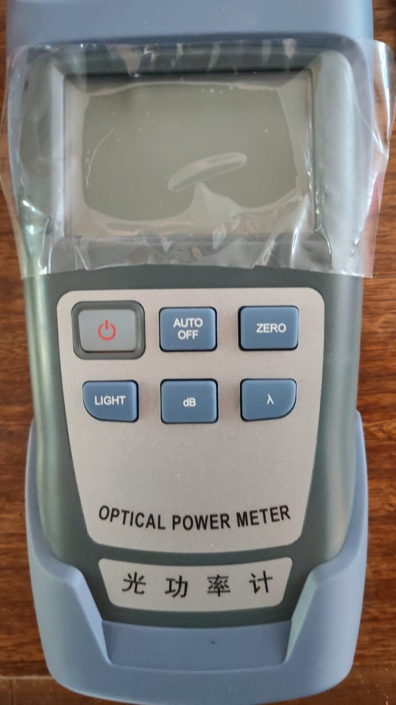 |

> [!NOTE]
> Fotos propias de mi set de herramientas. Las fotos de laboratorio de cada paso son de la demostración del docente, compartidas con el curso.

---

## 1. Seguridad

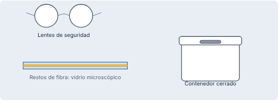

> [!WARNING]
> Los restos de fibra son fragmentos de vidrio microscópicos. Pueden clavarse en la piel o en los ojos y casi no se ven.

- Usa lentes de seguridad durante todo el procedimiento.
- Deposita **todo** resto de fibra en el contenedor cerrado, nunca en la mesa ni en el suelo.
- No comas ni bebas en el área de trabajo.
- Nunca mires directamente el extremo de una fibra con luz activa.

---

## 2. Paso a paso

> [!NOTE]
> Las fotos de laboratorio de esta sección corresponden a la demostración del docente, compartidas con el curso. Los dibujos y animaciones son esquemas ilustrativos.

### Paso 1: Preparar el protector

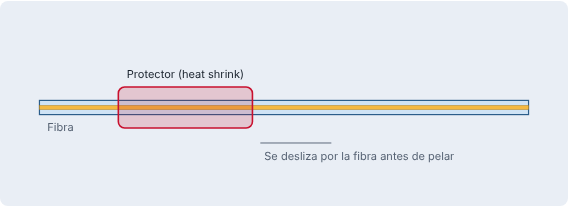

Desliza el protector de empalme (heat shrink) por una de las fibras **antes de pelar**.

> [!TIP]
> Error clásico: fusionar y recién ahí darse cuenta de que el protector quedó fuera. Para ponerlo hay que cortar y empezar de nuevo.

**Por qué importa:** el empalme deja el vidrio sin recubrimiento. El protector devuelve la resistencia mecánica, y solo se puede poner antes porque después no cabe por los extremos.

### Paso 2: Stripping (pelado)

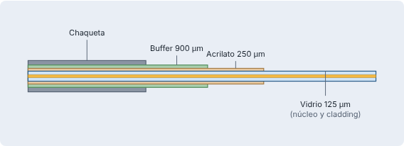

1. Mide con la regla guía el largo de fibra a pelar según el equipo.
2. Retira la chaqueta exterior del cable.
3. Según el tipo de cable, antes de llegar al buffer puede haber elementos de refuerzo que también se retiran.
4. Retira el buffer con la pinza correspondiente.
5. Con el stripper CFS-2, retira el recubrimiento de acrilato hasta dejar el vidrio de 125 µm.
6. Pela en un movimiento firme y recto, sin torcer.

> [!CAUTION]
> Si la fibra queda mellada o con rayas, se puede fracturar. Descártala y vuelve a pelar.

**Por qué importa:** el acrilato protege el vidrio de la humedad y los golpes, pero no debe llegar al arco porque se quema y deja residuos. Una mella en el vidrio es un punto de quiebre.

Los cables de exterior suelen llevar una chaqueta resistente y elementos de refuerzo que soportan la tracción y la intemperie. Así el vidrio, que es muy frágil, queda protegido en el centro.

*Herramientas de este paso: regla guía y stripper CFS-2 (fotos en la sección de herramientas).*

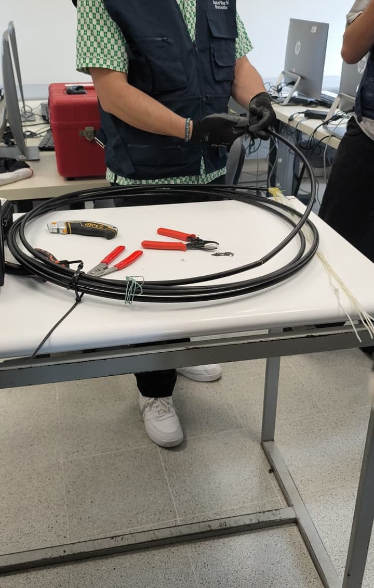

*Demostración del docente: mesa de preparación con el cable, cuchillo y alicates.*

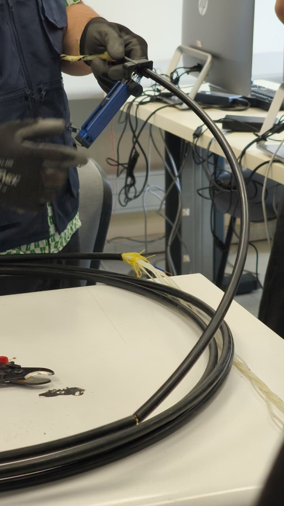 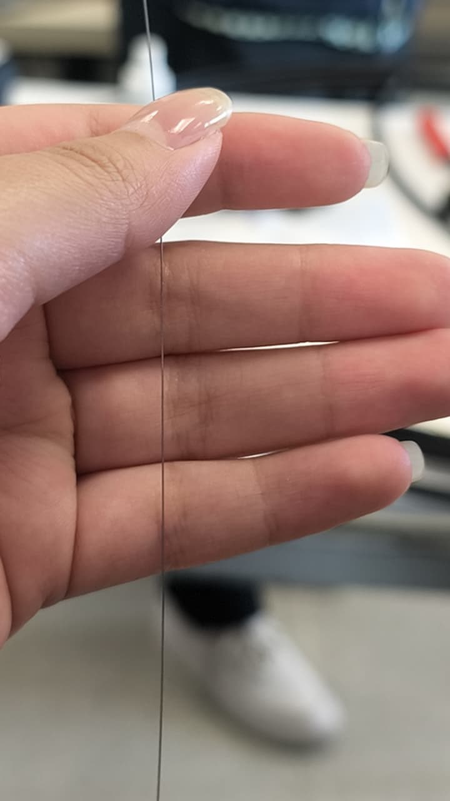

*Demostración del docente. Izquierda: retiro de la chaqueta exterior del cable, en el que se observa una chaqueta negra e hilos de refuerzo. Derecha: fibra ya pelada, solo vidrio.*

### Paso 3: Limpieza de precisión

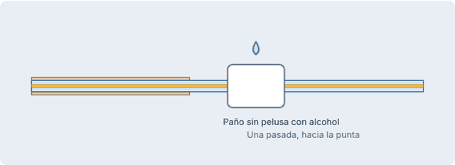

1. Humedece un paño sin pelusa con alcohol isopropílico de alta pureza.
2. Pasa el paño por el vidrio desnudo de una sola pasada, desde el recubrimiento hacia la punta.
3. Espera a que seque y **no toques** la fibra después de limpiarla.

> [!TIP]
> La suciedad en el vidrio produce atenuación y burbujas en la fusión. Limpiar de más nunca es problema, limpiar de menos sí.

**Por qué importa:** una partícula entre las puntas se calcina con el arco, deja burbujas o una zona débil y suma atenuación.

### Paso 4: Cleaving (corte)

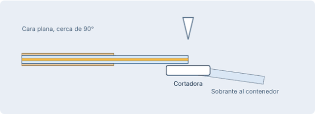

1. Coloca la fibra limpia en la cortadora, respetando la longitud de corte que indique el equipo.
2. Cierra la tapa y ejecuta el corte.
3. Retira la fibra sin rozar la punta contra nada y deposita el sobrante en el contenedor.

> [!WARNING]
> Una fibra con corte en ángulo o con astillas produce mala fusión y pérdidas altas. Si dudas del corte, repítelo.

**Por qué importa:** si la cara no es plana, las puntas no quedan en contacto parejo y la luz se desvía o se refleja en la unión. Por eso la fusionadora revisa el ángulo antes de iniciar el arco.

**Buen corte vs. mal corte:**

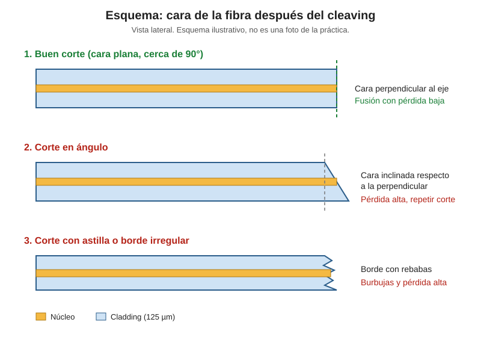

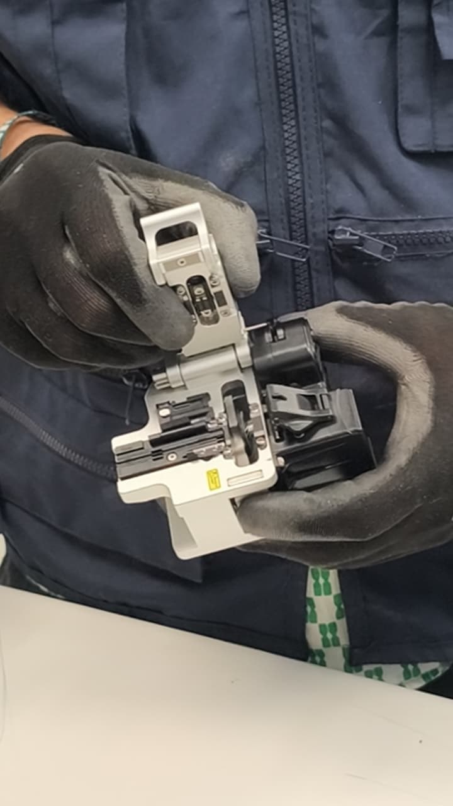

*Demostración del docente: cortadora de precisión del laboratorio.*

### Paso 5: Termofusión

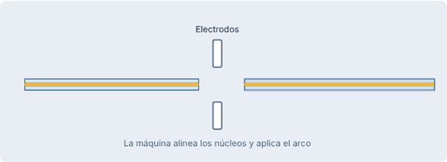

1. Ubica ambas fibras en los canales de la fusionadora, con las puntas cerca de los electrodos.
2. Cierra la tapa y revisa en pantalla que el ángulo de corte y la limpieza sean aceptables.
3. Selecciona el programa de fusión adecuado al tipo de fibra.
4. Deja que la máquina alinee por núcleo/cladding y aplique el arco eléctrico.
5. Observa el empalme en pantalla y anota la pérdida estimada.

**Por qué importa:** el arco funde el vidrio y la tensión superficial ayuda a alinear los claddings. Algunas fusionadoras alinean por núcleo y otras por cladding. Si los núcleos quedan desalineados, parte de la luz pasa al cladding y se pierde.

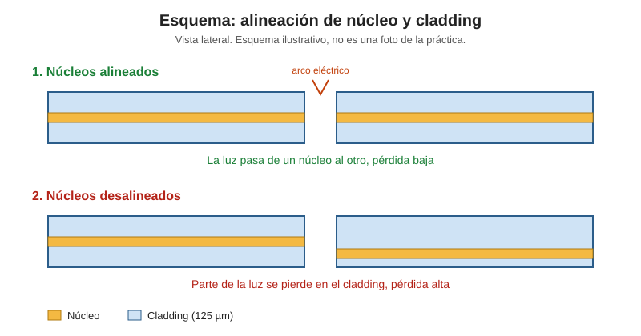

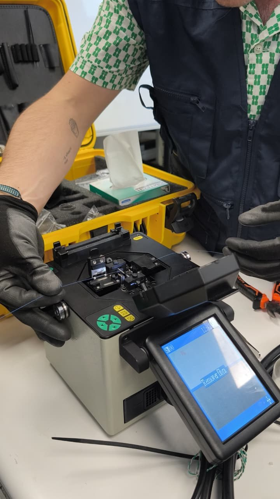 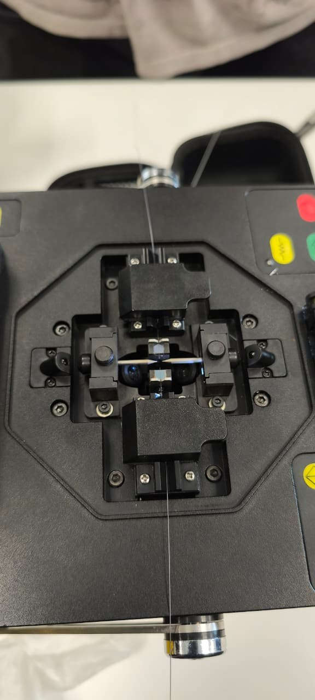 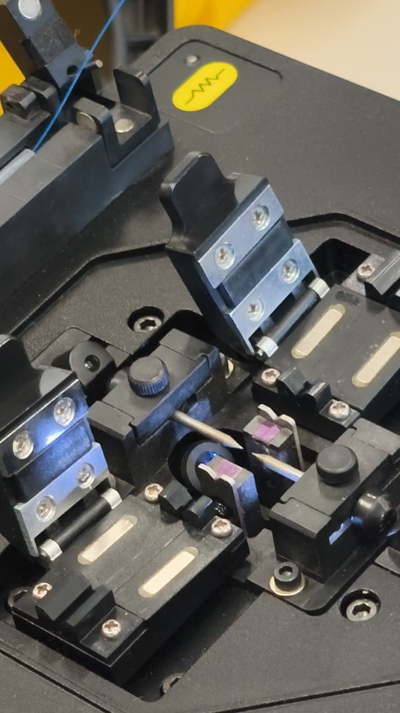

*Demostración del docente: posicionado de la fibra en la fusionadora y cámara de fusión con los electrodos.*

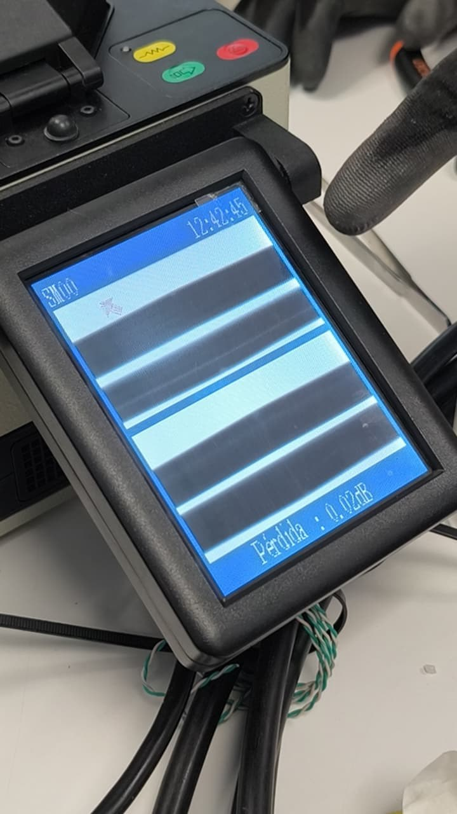

*Demostración del docente: pantalla de la fusionadora tras el arco, con pérdida estimada de 0,02 dB.*

### Paso 6: Protección del empalme

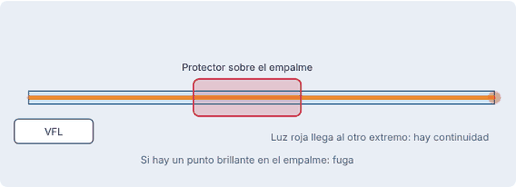

1. Retira la fibra empalmada con cuidado.
2. Desliza el protector sobre el empalme, centrándolo.
3. Colócalo en el horno de la fusionadora hasta que termine el ciclo.
4. Deja enfriar antes de manipular.

**Por qué importa:** el protector lleva una varilla de refuerzo y un tubo que se contrae con el calor (heat shrink). Juntos sellan el empalme y evitan que se doble o se quiebre.

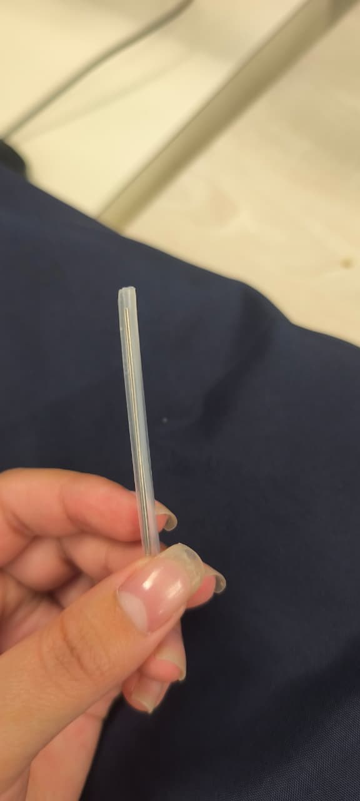 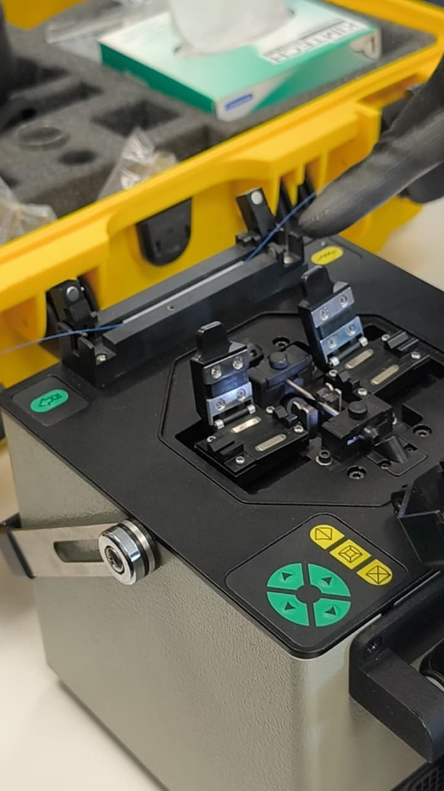 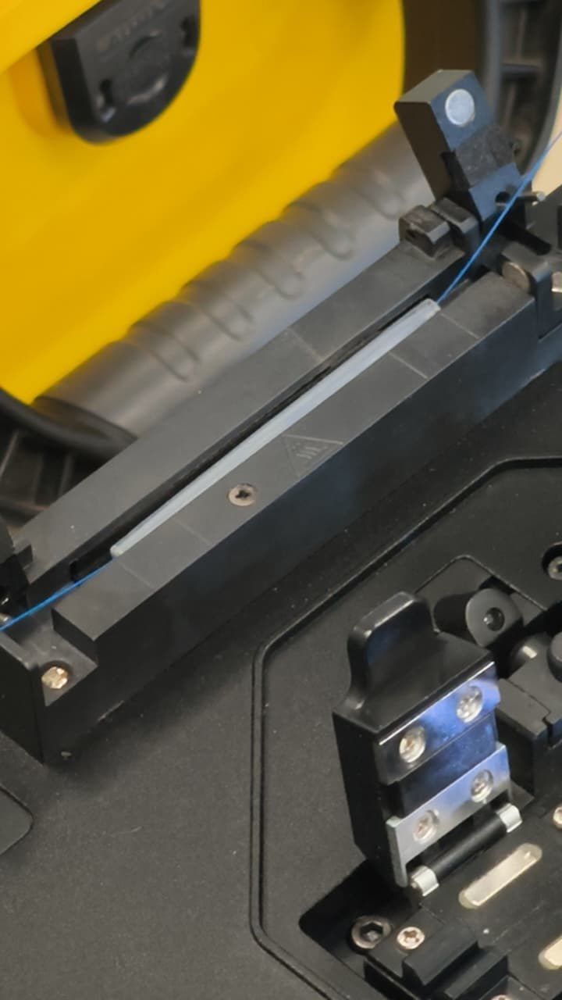 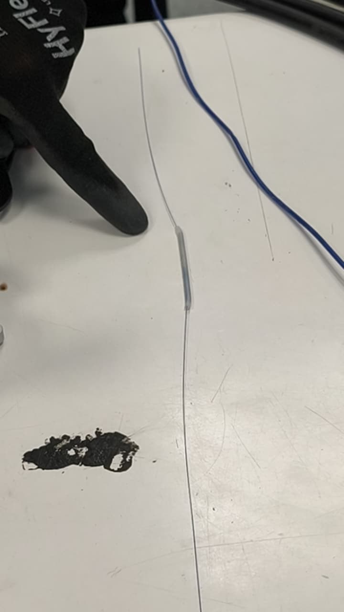

*Demostración del docente: protector de empalme, fibra llevada al horno, protector dentro del horno y empalme ya sellado.*

---

## 3. Análisis de resultados

| Pérdida estimada | Interpretación |
|---|---|
| Menor a 0,10 dB | Empalme bueno |
| Entre 0,10 y 0,30 dB | Revisar, puede aceptarse según la norma del proyecto |
| Mayor a 0,30 dB | Repetir el empalme |

> [!NOTE]
> Los umbrales exactos dependen de la norma del proyecto o del criterio del docente.

**Cómo se obtiene la pérdida:** la fusionadora la estima a partir de la imagen de las fibras (alineación, ángulo y deformación). No reemplaza una medición con medidor de potencia y fuente de luz, ni con un OTDR.

**Verificación de continuidad del núcleo con el VFL:**

1. Conecta el VFL a un extremo de la fibra con su adaptador.
2. Enciende la luz roja.
3. Comprueba que la luz salga por el otro extremo, lo que indica continuidad.
4. Mira el empalme y el protector. Un punto brillante indica una fuga o un empalme defectuoso.

> [!WARNING]
> Nunca mires de frente el extremo de la fibra con el VFL encendido. El VFL confirma continuidad, pero no mide la pérdida en dB.

**Resultado de la demostración del docente:** la fusionadora estimó una pérdida de **0,02 dB**, que según la tabla de arriba corresponde a un empalme bueno. Es un valor estimado por la máquina, no una medición con medidor de potencia.

---

## 4. Troubleshooting

| Problema | Causa probable | Solución |
|---|---|---|
| Pérdida alta | Suciedad o corte en ángulo | Limpiar y repetir el corte |
| Burbujas en el empalme | Residuos en el vidrio | Limpiar mejor antes de fusionar |
| Fibra se quiebra al pelar | Stripper mal usado o fibra mellada | Pelar de nuevo con movimiento recto |
| Protector no entra | Se puso después de fusionar | Hacer el empalme otra vez |
| La fusionadora muestra un mensaje de error | Mal corte, suciedad o fibra mal posicionada | Limpiar, cortar de nuevo y reposicionar la fibra |
| Punto de luz roja en el empalme con el VFL | Fuga por empalme defectuoso | Repetir el empalme |

---

## 5. Reflexión final

Al observar la primera práctica de fusión de fibra realizada por nuestro docente, pudimos corroborar lo mencionado en el manual, desde la importancia de las distintas capas de protección y la cubierta exterior del cable hasta la precisión en el corte y el cleaving de la fibra misma. El uso adecuado de las herramientas siempre debe ir acompañado de un control de fallos mediante la propia fusionadora, ya que cualquier anomalía o pérdida alta de decibelios (dB) debe rectificarse de inmediato, incluso si eso implica comenzar el proceso de nuevo. Finalmente, al obtener una pérdida aceptable de 0,02 dB, se procedió a su protección y sellado térmico utilizando el protector de empalme (heat shrink), por lo que contar con el manual y la experiencia práctica de la fusión es crítico para nosotras como futuras profesionales del área de telecomunicaciones, puesto que una falta de prolijidad en las redes actuales, como en el despliegue de infraestructuras FTTx (Fiber to the x) o GPON (Gigabit Passive Optical Network), puede traducirse en atenuaciones críticas y en una degradación importante del servicio a gran escala. Cabe señalar que los 0,02 dB son una pérdida estimada por la fusionadora, y no reemplazan una medición con medidor de potencia. Como aspecto a mejorar, practicaría el pelado y el corte con un trozo de fibra de prueba antes de una sesión presencial. Por todo esto, la práctica constante y el rigor técnico deben ser siempre una prioridad en nuestra formación como profesionales de TI.

---

## Referencias

- ITU-T G.652: fibra óptica monomodo estándar.
- ANSI/TIA-568: cableado de telecomunicaciones, incluye criterios de pérdida por empalme.
- Demostración del docente y manuales de las herramientas usadas.

