# Manual Express: Fusión de Fibra Óptica

Manual técnico-pedagógico para usar en el banco de trabajo, desde el celular o el notebook.

**Asignatura:** Infraestructura de Redes (TCB304) | **Sede:** La Serena | 

**Autora:** [Katherine Valle T.]

---

## Glosario exprés

| Término | Definición |
|---|---|
| **Núcleo (core)** | Centro de vidrio de la fibra por donde viaja la luz. En monomodo mide cerca de 9 µm. |
| **Cladding** | Capa de vidrio que rodea al núcleo (125 µm en total). Refleja la luz y la mantiene dentro del núcleo. |
| **Cleaving** | Corte de precisión de la fibra para dejar una cara plana y perpendicular al eje, cercana a 90°. |
| **Atenuación** | Pérdida de potencia óptica de la señal, medida en dB. En un empalme por fusión se busca lo más cerca posible de 0 dB. |

---

## Materiales y herramientas

| Herramienta | Uso en la práctica |
|---|---|
| **Stripper de fibra CFS-2** | Pelado por etapas hasta dejar el vidrio de 125 µm. |
| **Pinza para chaqueta exterior** | Retiro de la cubierta del cable antes de llegar a la fibra. |
| **Regla guía de longitud** (canales 250 y 900) | Medir el largo de fibra a pelar según lo que pida el equipo. |
| **Cortadora SKL-60S** | Cleaving, corte perpendicular de la fibra. |
| **Alcohol isopropílico y paños sin pelusa** | Limpieza de precisión antes del corte y la fusión. |
| **Localizador visual de fallas (VFL, Visual Fault Locator)** | Inyecta luz roja en la fibra para verificar la continuidad del núcleo y ubicar cortes o fugas. |
| **Medidor de potencia óptica** | Medir potencia y pérdida del enlace. Tiene botones de encendido, AUTO OFF, ZERO, LIGHT, dB y λ (selección de longitud de onda). |
| **Fusionadora y protectores de empalme** | Disponibles en el laboratorio, no en mi set. |

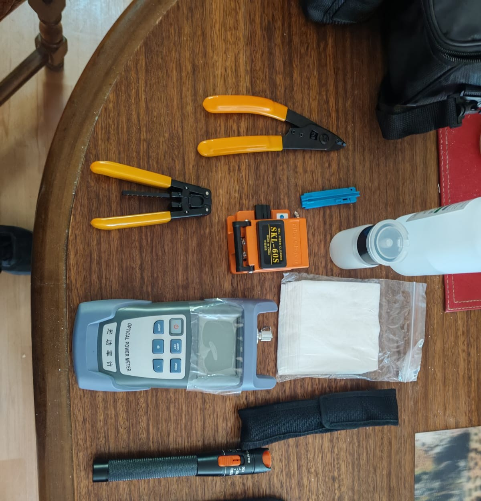

| Stripper CFS-2 | Pinza de chaqueta | Regla guía | Medidor de potencia |
|---|---|---|---|
| 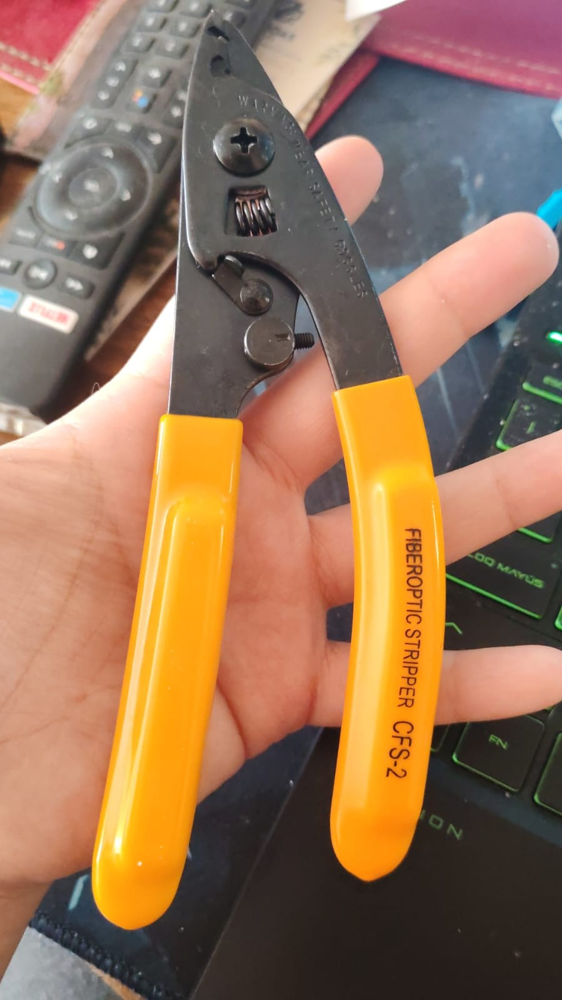 | 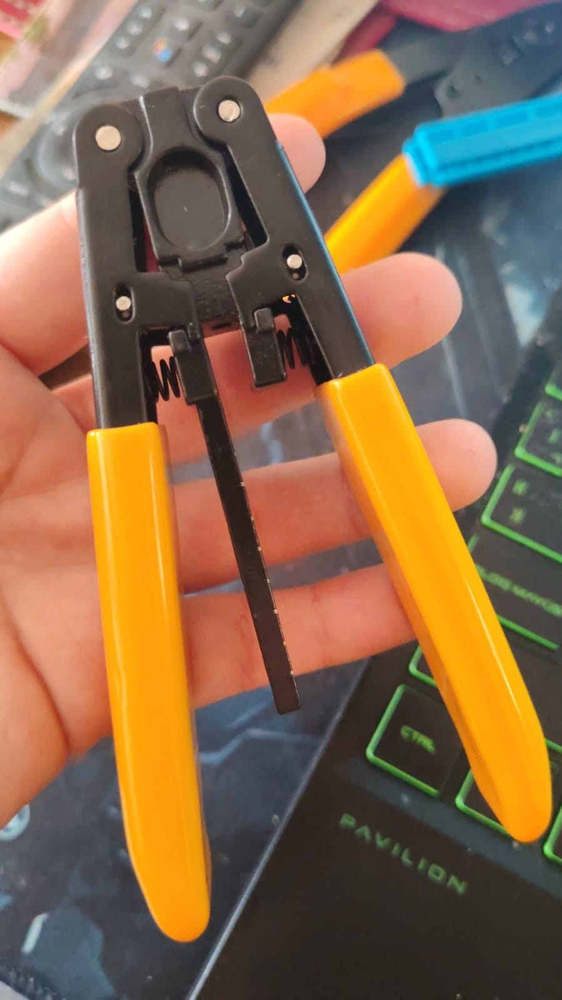 | 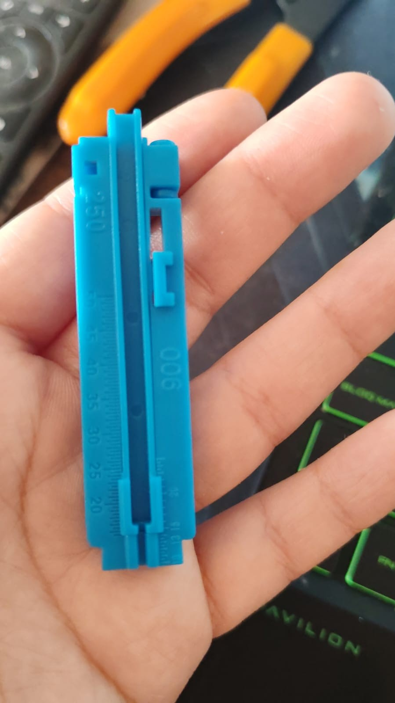 | 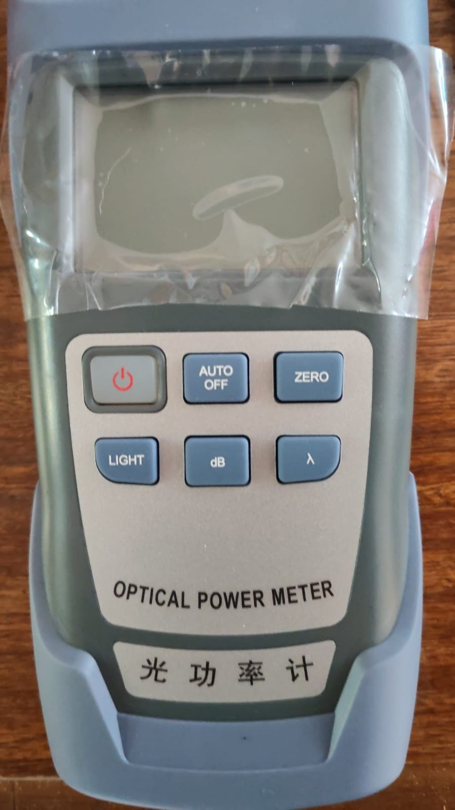 |

> [!NOTE]
> Fotos propias de mi set de herramientas. Las fotos del procedimiento con fibra se agregarán después de la sesión de laboratorio.

---

## 1. Seguridad

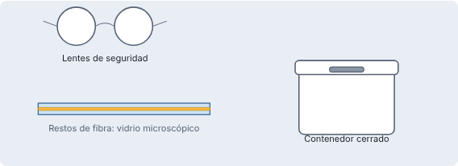

> [!WARNING]
> Los restos de fibra son fragmentos de vidrio microscópicos. Pueden clavarse en la piel o en los ojos y casi no se ven.

- Usa lentes de seguridad durante todo el procedimiento.
- Deposita **todo** resto de fibra en el contenedor cerrado, nunca en la mesa ni en el suelo.
- No comas ni bebas en el área de trabajo.
- Nunca mires directamente el extremo de una fibra con luz activa.

---

## 2. Paso a paso

### Paso 1: Preparar el protector

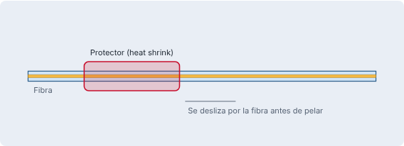
Desliza el protector de empalme (heat shrink) por una de las fibras **antes de pelar**.

> [!TIP]
> Error clásico: fusionar y recién ahí darse cuenta de que el protector quedó fuera. Para ponerlo hay que cortar y empezar de nuevo.

### Paso 2: Stripping (pelado)

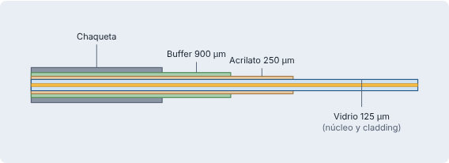
1. Mide con la regla guía el largo de fibra a pelar según el equipo.
2. Retira la chaqueta exterior y el buffer con la pinza correspondiente.
3. Con el stripper CFS-2, retira el recubrimiento de acrilato hasta dejar el vidrio de 125 µm.
4. Pela en un movimiento firme y recto, sin torcer.

> [!CAUTION]
> Si la fibra queda mellada o con rayas, se puede fracturar. Descártala y vuelve a pelar.

*Para el pelado uso la regla guía y el stripper CFS-2 (fotos en la sección de herramientas).*

`[pendiente: foto del laboratorio]`

### Paso 3: Limpieza de precisión

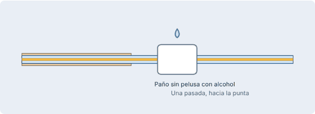
1. Humedece un paño sin pelusa con alcohol isopropílico de alta pureza.
2. Pasa el paño por el vidrio desnudo de una sola pasada, desde el recubrimiento hacia la punta.
3. Espera a que seque y **no toques** la fibra después de limpiarla.

> [!TIP]
> La suciedad en el vidrio produce atenuación y burbujas en la fusión. Limpiar de más nunca es problema, limpiar de menos sí.

### Paso 4: Cleaving (corte)

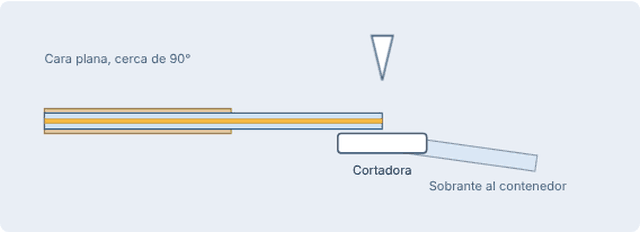
1. Coloca la fibra limpia en la cortadora, respetando la longitud de corte que indique el equipo.
2. Cierra la tapa y ejecuta el corte.
3. Retira la fibra sin rozar la punta contra nada y deposita el sobrante en el contenedor.

> [!WARNING]
> Una fibra con corte en ángulo o con astillas produce mala fusión y pérdidas altas. Si dudas del corte, repítelo.

**Buen corte vs. mal corte:**

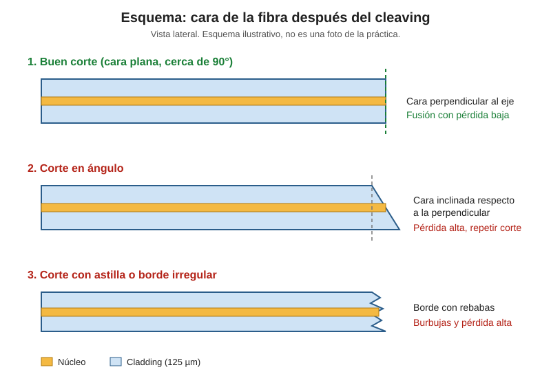

`[pendiente: foto del laboratorio, buen corte]`

`[pendiente: foto del laboratorio, mal corte]`

### Paso 5: Termofusión

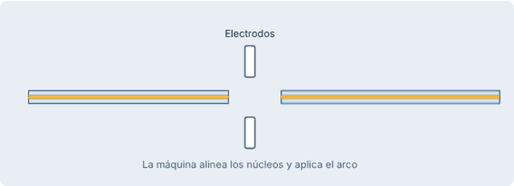
1. Ubica ambas fibras en los canales de la fusionadora, con las puntas cerca de los electrodos.
2. Cierra la tapa y revisa en pantalla que el ángulo de corte y la limpieza sean aceptables.
3. Selecciona el programa de fusión adecuado al tipo de fibra.
4. Deja que la máquina alinee por núcleo/cladding y aplique el arco eléctrico.
5. Observa el empalme en pantalla y anota la pérdida estimada.

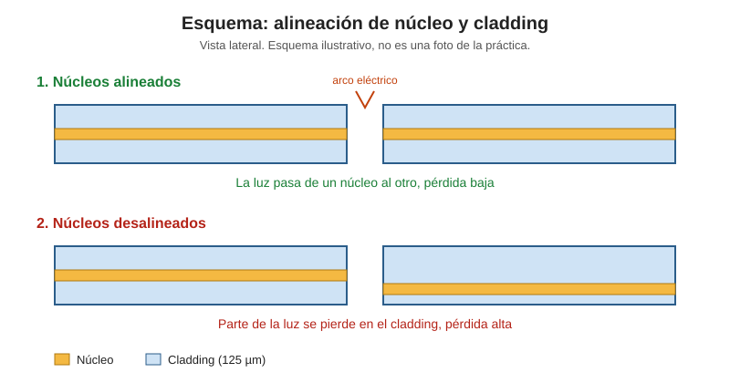

`[pendiente: foto del laboratorio, fusionadora en pantalla]`

### Paso 6: Protección del empalme

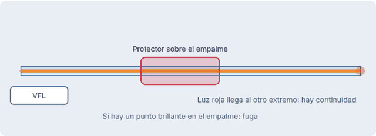
1. Retira la fibra empalmada con cuidado.
2. Desliza el protector sobre el empalme, centrándolo.
3. Colócalo en el horno de la fusionadora hasta que termine el ciclo.
4. Deja enfriar antes de manipular.

---

## 3. Análisis de resultados

| Pérdida estimada | Interpretación |
|---|---|
| Menor a 0,10 dB | Empalme bueno |
| Entre 0,10 y 0,30 dB | Revisar, puede aceptarse según la norma del proyecto |
| Mayor a 0,30 dB | Repetir el empalme |

> [!NOTE]
> Los umbrales exactos dependen de la norma o del criterio del docente. Ajusta esta tabla a lo que se haya indicado en clases.

**Verificación de continuidad del núcleo:** [Describan cómo lo comprobaron, por ejemplo con localizador visual de fallas (VFL) o medidor de potencia].

**Resultados de mi práctica:** [Pérdida obtenida, observaciones].

---

## 4. Troubleshooting

| Problema | Causa probable | Solución |
|---|---|---|
| Pérdida alta | Suciedad o corte en ángulo | Limpiar y repetir el corte |
| Burbujas en el empalme | Residuos en el vidrio | Limpiar mejor antes de fusionar |
| Fibra se quiebra al pelar | Stripper mal usado o fibra mellada | Pelar de nuevo con movimiento recto |
| Protector no entra | Se puso después de fusionar | Hacer el empalme otra vez |

---

## 5. Reflexión final

- **Qué salió bien:** [...]
- **Qué dificultades tuve:** [...]
- **Qué mejoraría:** [...]
